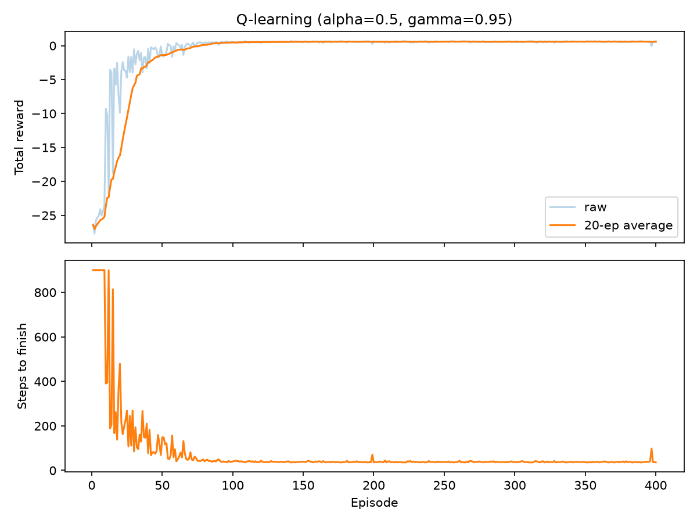
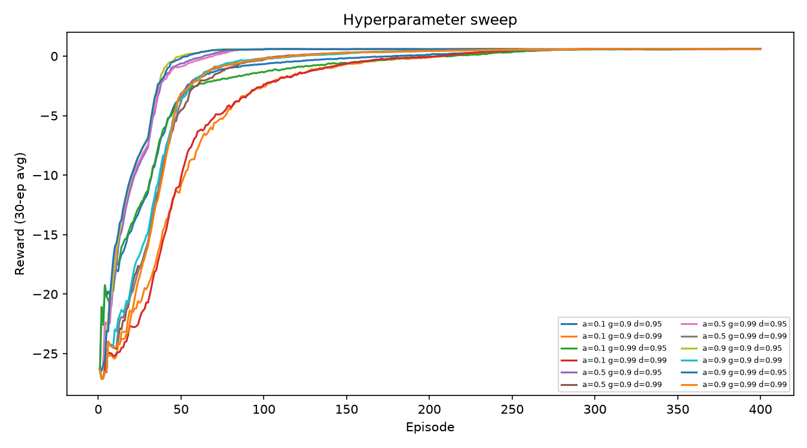

# Dungeon Escape AI: Pathfinding & Reinforcement Learning Game

A 2D maze game in Python where enemies hunt the player with A* search and a Q-learning agent learns to solve randomly generated mazes.


**Tech:** Python, Pygame, NumPy, pandas, Matplotlib, pytest

## Features
- **Procedural mazes:** randomized depth-first-search generation, with some extra walls removed so enemies have alternate routes.
- **A\* pathfinding:** heap-based priority queue (`heapq`) with a Manhattan-distance heuristic.
- **Enemy AI:** a three-state finite-state machine: **patrol → chase → return**. The enemy color shows its state (yellow = patrol, red = chase, purple = return).
- **Q-learning agent:** a NumPy Q-table with an epsilon-greedy policy that learns to solve a generated maze.
- **Training logs:** each episode's reward, steps and epsilon are logged to a pandas DataFrame, saved as CSV and plotted with Matplotlib.
- **Tests:** 25 pytest tests covering pathfinding, the enemy state machine and the RL code.

## Project structure
```
dungeon/
  level.py         maze generation and grid helpers
  pathfinding.py   A* with heapq
  entities.py      Player and Enemy (state machine)
  rl.py            maze environment, Q-learning agent, training loop
  game.py          Pygame front-end
tests/             pytest suite
main.py            run the game
train_rl.py        train the agent, log, plot, hyperparameter sweep
results/           training log, plots, sweep summary
```

## Setup
Tested on Python 3.14 (macOS).

```bash
git clone https://github.com/roquecesar/dungeon-escape-ai.git
cd dungeon-escape-ai
python3 -m venv .venv
source .venv/bin/activate
pip install -r requirements.txt
```

`requirements.txt` uses `pygame-ce`, a maintained fork of Pygame that ships prebuilt wheels for newer Python versions. The code still uses `import pygame`.

## Run
```bash
python main.py                 # play the game
python train_rl.py             # train Q-learning, save log and reward curve
python train_rl.py --sweep     # compare 12 hyperparameter settings
pytest -q                      # run the tests
```

**Controls:** Arrow keys or WASD to move. **H** trains Q-learning on the current maze and shows its path. **R** generates a new maze. **Esc** quits.

## Results
Single training run (15x15 maze, 400 episodes, seed 42):



Hyperparameter sweep over learning rate (alpha), discount factor (gamma) and epsilon decay. Each setting was trained for 400 episodes on the same maze and seed:

| alpha | gamma | eps decay | avg reward (last 50) | avg steps (last 50) | solved |
|---|---|---|---|---|---|
| 0.9 | 0.90 | 0.99 | 0.6116 | 37.44 | yes |
| 0.9 | 0.90 | 0.95 | 0.6060 | 37.52 | yes |
| 0.9 | 0.99 | 0.95 | 0.6042 | 37.46 | yes |
| 0.5 | 0.99 | 0.99 | 0.5978 | 38.10 | yes |
| 0.5 | 0.90 | 0.95 | 0.5976 | 37.88 | yes |
| 0.1 | 0.90 | 0.99 | 0.5938 | 38.18 | yes |
| 0.5 | 0.90 | 0.99 | 0.5934 | 38.06 | yes |
| 0.1 | 0.99 | 0.99 | 0.5930 | 38.10 | yes |
| 0.9 | 0.99 | 0.99 | 0.5908 | 38.24 | yes |
| 0.5 | 0.99 | 0.95 | 0.5874 | 38.18 | yes |
| 0.1 | 0.90 | 0.95 | 0.5816 | 38.68 | yes |
| 0.1 | 0.99 | 0.95 | 0.5814 | 38.30 | yes |

All 12 settings solved the maze, and the differences between them are small. This sweep used a single maze and a single seed, so a natural next step is to repeat it across many mazes and seeds.



## How it works
- **A\*** expands the node with the lowest `g + h`, where `g` is the path cost so far and `h` is the Manhattan distance to the goal. On a 4-directional grid with unit costs, Manhattan distance never overestimates, so the path is optimal.
- **Enemy FSM:** an enemy in patrol or return mode switches to chase when the player is within its detection radius (measured in path steps). A chasing enemy switches to return when the player gets farther than the lose radius or becomes unreachable. A returning enemy switches back to patrol when it reaches its home tile.
- **Q-learning:** the state is the tile index and the actions are up, down, left and right. The reward is +1 for reaching the exit, -0.01 per step and -0.05 for hitting a wall. Epsilon starts at 1.0 and decays each episode, so the agent explores first and exploits later.
